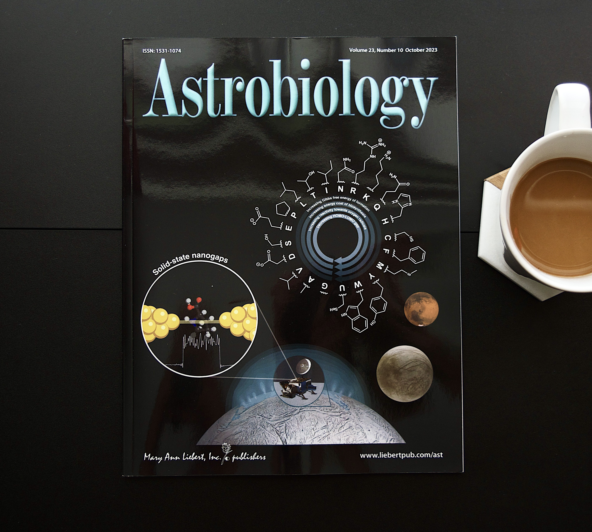

## Trasfondo

Encélado, luna de Saturno, y Europa, luna de Júpiter, esconden océanos de agua líquida bajo su hielo, lo que las convierte en algunos de los lugares más prometedores para buscar vida más allá de la Tierra. Encélado incluso lanza al espacio material de su interior en un penacho de granos de hielo que una nave podría atravesar y muestrear.

La vida como la conocemos depende de los aminoácidos, los componentes básicos de las proteínas, y de polímeros informacionales como el ADN y el ARN, que guardan la información genética. Ambos son objetivos naturales para un instrumento de detección de vida.

## El problema

Si esas moléculas existen en un mundo oceánico, probablemente estén muy diluidas, a niveles de partes por mil millones o incluso partes por billón. ¿Por qué tan poco? Un océano es enorme, así que todo lo que se disuelve en él queda muy disperso, y los aminoácidos se descomponen lentamente con el tiempo. A juzgar por la rapidez con que se degradan, encontrar aminoácidos en esos océanos por encima de 1 nanomolar, menos de 100 partes por billón, ya apuntaría a algo que los está produciendo activamente, sea la geoquímica o la vida.

Así que un instrumento tiene que encontrar moléculas a esos niveles y, a la vez, ser pequeño, liviano, de bajo consumo y lo suficientemente resistente para sobrevivir el lanzamiento, las vibraciones y las condiciones del espacio.

## Qué es ELIE

ELIE, el Instrumento Electrónico de Detección de Vida para Encélado/Europa, es un detector de moléculas individuales diseñado para buscar aminoácidos y polímeros informacionales como el ADN y el ARN. Surgió de un sistema de nanobrechas de mesa desarrollado en la Universidad de Osaka, y nuestra meta ha sido hacer esa tecnología lo suficientemente pequeña, liviana y sencilla para volar.

La ilustración de abajo muestra el primer prototipo de ELIE: un amplificador de bajo ruido, una computadora portátil y una jaula de Faraday que contiene el sensor, fijados a una sola placa base junto a dos acelerómetros.

## Cómo funciona

El corazón de ELIE es una nanobrecha. Un alambre de oro diminuto sobre un chip flexible se dobla hasta que se rompe, y quedan dos electrodos de oro separados por un espacio del tamaño de una sola molécula.

Primero, un voltaje pequeño hace que los electrones atraviesen el espacio vacío por efecto túnel, creando un flujo de corriente constante. Luego, cuando una molécula entra en ese espacio, modula ese flujo de electrones de una forma relacionada con sus propiedades electrónicas. Cada molécula deja una señal breve en la corriente, y la forma de esa señal nos ayuda a saber cuál era.

## Lo que encontramos

Con nuestro primer prototipo compacto detectamos moléculas individuales del aminoácido L-prolina.

Desde temprano mostramos una buena correlación entre la brecha HOMO-LUMO de los aminoácidos y la conductancia que producen en la nanobrecha. Eso nos llevó a proponer que ELIE podría medir la brecha HOMO-LUMO de forma indirecta.

 También exploramos cómo los patrones de abundancia que detecta ELIE podrían ayudar a distinguir los aminoácidos producidos por la vida de los producidos por la química por sí sola.

## Fuera del laboratorio

El primer prototipo necesitaba que la brecha se ajustara a mano, y eso solo se podía sostener por ratos cortos. Para la siguiente versión añadimos un actuador piezoeléctrico automático que controla la brecha en tiempo real, y llevamos a ELIE a un vuelo parabólico a bordo del G-Force One. A lo largo de 20 parábolas, detectó moléculas individuales de L-prolina bajo la gravedad de Marte, una gravedad como la de la Luna y Europa, y en microgravedad, y mantuvo un desempeño consistente y una brecha estable mientras cambiaba la gravedad. El ruido eléctrico limitó cuántos datos buenos pudimos recopilar, y es una de las próximas cosas a mejorar camino a un instrumento más maduro.

## Mi papel

Soy co-primer autor del artículo de 2023 en *Astrobiology* que presenta a ELIE, y primer autor del artículo de 2024 en la IEEE Aerospace Conference sobre su prueba en vuelo. Analicé los datos de detección de moléculas individuales de ELIE en tierra y en vuelo parabólico, y evalué cómo los cambios de gravedad afectan la detección con nanobrechas.

También diseñé la portada del número de *Astrobiology* en el que se publicó el artículo sobre ELIE (volumen 23, número 10, octubre de 2023), que reúne la nanobrecha, los aminoácidos que lee y los mundos que fue diseñado para explorar.

> Detectar vida en otro lugar podría depender de leer moléculas individuales con suficiente confianza para decir: esto lo hizo la biología.
